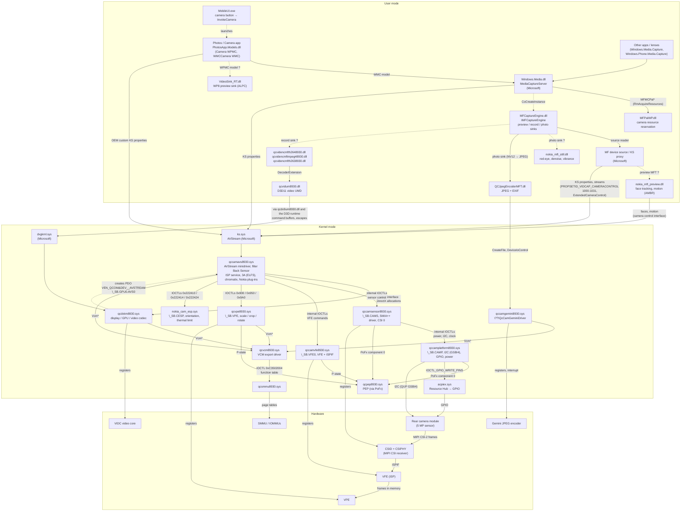

# Camera stack (rear camera)

### Components

Built from the [drivers](../drivers/README.md) and [libraries](../libraries/README.md) pages. Solid arrows: calls / IOCTLs / data. Dotted arrows: creation (PDO, COM object, DLL loading) or links that aren't confirmed (`?`). The Microsoft components (`Windows.Media.dll`, the MF device source, `ks.sys`, `dxgkrnl.sys`, PoFx) are not documented here.

The Lumia 520 has no front camera and no flash: [qccamfrontsensor8930.sys](../drivers/qccamfrontsensor8930.md) and [qccamflash8930.sys](../drivers/qccamflash8930.md) are loaded (shared Nokia code base) but their hardware detection fails, so they aren't in the chart.

Notes:
- [qccamavs8930.sys](../drivers/qccamavs8930.md) contains most of the camera stack (ISP service, 3A algorithms, tuning, multipass snapshot). The other kernel drivers are thin hardware drivers reached through device interfaces; only [qccamgemini8930.sys](../drivers/qccamgemini8930.md) has a symbolic link and is opened from user mode.
- The camera driver is a child of the display adapter ([qcdxkm8930.sys](../drivers/qcdxkm8930.md#child-devices)), so the display and the camera share the same buffers through the [allocation sharing interface](../drivers/qcdxkm8930.md#allocation-sharing-interface).
- The process that loads [nokia_mft_preview.dll](../libraries/nokia_mft_preview.md), [nokia_mft_still.dll](../libraries/nokia_mft_still.md), [QCJpegEncoderMFT.dll](../libraries/qcjpegencodermft.md) and the video encoder MFTs isn't known: the links to the capture engine are guesses (`?`). [MFCaptureEngine.dll](../libraries/mfcaptureengine.md#photo-encoder) does use the Qualcomm phone JPEG encoder for NV12 photos.
- The client of the `0x222400`…`0x22241C` IOCTLs of [nokia_cam_esp.sys](../drivers/nokia_cam_esp.md#clients) (named event on camera state, device orientation) isn't known.
- The Windows Phone 8 camera API (`Windows.Phone.Media.Capture`) isn't analysed; [VideoSink_RT.dll](../libraries/videosink_rt.md) is its preview sink according to its class name.
- The rear sensor runs its own 8051 firmware (mask ROM + a RAM patch uploaded from the `.dcc` file at each power on): see [Rear camera sensor firmware](../sensor_firmware/README.md).
- The camera button is handled by [msgpiowinphone.sys](../drivers/msgpiowinphone.md) → [kbdclasswp.sys](../drivers/kbdclasswp.md) → [MobileUI.exe](../applications/mobileui.md) / [ShellChrome.dll](../libraries/shellchrome.md) (`InvokeCamera`).
